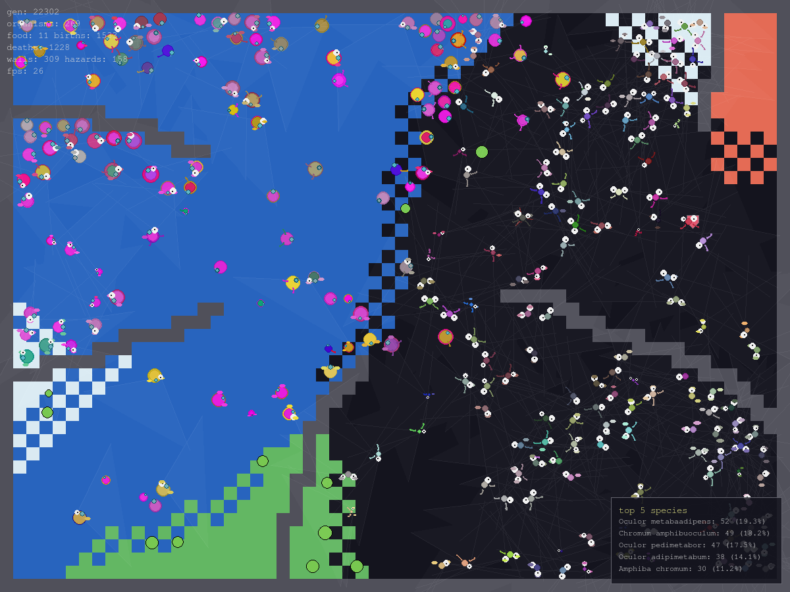

# Wee Life 2 — Artificial Life Simulation

A Python/Pygame sandbox where units live on a board, are controlled by a genetic algorithm, and are built from DNA-coded body parts.

## Table of contents

- [Wee Life 2 — Artificial Life Simulation](#wee-life-2--artificial-life-simulation)
  - [Table of contents](#table-of-contents)
  - [Run](#run)
  - [Statistics output](#statistics-output)
  - [Screenshot](#screenshot)
  - [Map editor](#map-editor)
  - [Sample maps](#sample-maps)
  - [Project structure](#project-structure)
  - [Gene system](#gene-system)
  - [Configuration](#configuration)
    - [Configuration files](#configuration-files)
    - [Window / rendering](#window--rendering)
    - [World](#world)
    - [Physics / organism](#physics--organism)
    - [Energy](#energy)
    - [Lifespan / reproduction](#lifespan--reproduction)
    - [Random spawn weighting](#random-spawn-weighting)
    - [Death / remains](#death--remains)
    - [Hazards](#hazards)
    - [Water](#water)
    - [Tiles](#tiles)
    - [Colors](#colors)
  - [DNA](#dna)
    - [Gene parameters](#gene-parameters)
  - [Current gene set](#current-gene-set)
  - [AI / drives](#ai--drives)
  - [World features](#world-features)


## Run

```bash
uv run wee-life2
```

Keyboard:

- `ESC` — quit
- `H` — toggle help / controls
- `L` — toggle body-part / gene / terrain legend
- `G` — toggle age greying
- `T` — toggle top-5 species panel
- `SPACE` — pause / resume
- `P` — save screenshot
- `R` — spawn a few random organisms
- `E` — toggle map edit mode

Mouse:

- `LMB` on empty tile — spawn a random organism
- `RMB` on organism — remove it

While paused, hovering an organism shows its DNA/stats panel, and its `generation` number.

The top-left overlay shows the simulation `tick` (wall-clock ticks at `FPS`), plus the current `max gen` and `min gen` of the living population. `generation` is the biological generation of an organism: `1` for the initial/random spawn, `parent + 1` for asexual clones, and `max(parent1, parent2) + 1` for sexual offspring.

## Statistics output

Each run writes a timestamped directory under `data/runs/` (configurable via `config.STATS_BASE_DIR` or disabled with `--no-stats`):

- `timeseries.csv` — population-level metrics sampled every `config.STATS_SAMPLE_INTERVAL` ticks. Columns include `tick`, `organisms`, `food`, `births`, `deaths`, `species_count`, `diversity`, `avg_energy`, `avg_age`, `max_generation`, `min_generation`, and `top_5`.
- `events.jsonl` — birth/death/speciation/extinction events.
- `census.jsonl` — per-species snapshots every `config.STATS_CENSUS_INTERVAL` ticks, including `count`, `pct`, `avg_energy`, `avg_age`, `min_generation`, and `max_generation`.
- `organisms.jsonl` — one record per created organism, including `uid`, `name`, `generation`, `parents`, position, angle, radius, and full `dna`. `parents` lists the uids the organism descends from (two for sexual reproduction, one for asexual cloning, empty for the founding population), so the pedigree of a run can be reconstructed offline.
- `meta.json` and `map.json` — run metadata and the tile map.

`generation` lets you compare how fast different species are producing new biological generations, independent of the wall-clock tick count.

## Screenshot



## Map editor

Edit the board and save it to `world_map.json`. The saved map is loaded
automatically the next time you run the simulation.

```bash
uv run wee-life2 --edit-map
```

Editor controls:

- `LMB` — draw selected tile
- `RMB` — erase (empty tile)
- `0` — empty
- `1` — wall
- `2` — radioactive
- `3` — lava
- `4` — water
- `5` — heal
- `R` — randomise whole map
- `C` — clear map (keeps border walls)
- `S` — save
- `E` — exit editor
- `ESC` — quit

You can also use a custom map file:

```bash
uv run wee-life2 --edit-map --map-file my_map.json
uv run wee-life2 --map-file my_map.json
```

## Sample maps

The `maps/` directory contains a few ready-made environments for observing organism behaviour:

- `maze` — a labyrinth of corridors with a few radioactive traps
- `islands` — wall islands surrounded by lava rings
- `arena` — a central circular wall with hazards in the outer ring
- `corridors` — horizontal lanes separated by walls and lava/radioactive patches
- `quadrants` — four chambers, each with a different hazard layout

Run a sample map with:

```bash
uv run wee-life2 --map-file maps/maze.json
```

## Project structure

```text
src/wee_life2/
├── main.py                 # CLI entry point
├── simulation.py           # World + renderer loop
├── stats.py                # per-run statistics logging
├── core/
│   ├── config.py           # constants
│   ├── dna.py              # genome, crossover, mutation
│   ├── food.py             # edible/poisoned remains
│   ├── geometry.py         # shared vector/angle helpers
│   ├── map_storage.py      # save/load tile maps
│   ├── organism.py         # Organism, BodyPart
│   ├── spatial_grid.py     # fast organism lookup
│   ├── species_naming.py   # latin-sounding species labels
│   ├── tile_map.py         # tile grid and ray queries
│   └── world.py            # board, food, hazards, walls
├── genes/
│   ├── base.py             # Gene base class, BodyPartBlueprint
│   ├── eye.py              # vision / steering
│   ├── jaw.py              # eating and biting
│   ├── leg.py              # movement
│   ├── spike.py            # contact damage
│   ├── armor.py            # damage reduction
│   ├── toxin_gland.py      # poison on death / resistance
│   ├── venom.py            # poison bite (damage over time)
│   ├── asexual.py          # solitary cloning reproduction
│   ├── cannibal.py         # preys on same-species kin
│   ├── color.py            # body colour and glow
│   ├── metabolism.py       # energy, lifespan, radiation
│   ├── scent.py            # 360-degree smell
│   ├── pheromone.py        # mating scent signal
│   ├── fat.py              # energy storage
│   ├── regeneration.py     # healing when hurt
│   ├── fear.py             # danger detection / escape
│   ├── touch.py            # short-range wall avoidance
│   ├── memory.py           # long-term terrain memory
│   └── geometry.py         # gene-specific geometry helpers
├── render/
│   ├── actions.py          # UI action intents
│   ├── body_drawing.py     # body part renderers
│   ├── legend_drawing.py   # legend icon renderers
│   ├── map_editor.py       # interactive map editor
│   ├── renderer.py         # Pygame drawing
│   └── tile_drawing.py     # tile rendering
└── physics/
    └── __init__.py         # future collision / vector helpers
```

## Gene system

Each gene is a self-contained class in `genes/`.  It:

1. declares `kind`, `default_params`
2. returns `BodyPartBlueprint` instances from `body_parts(base_color)` — these become the visible body blocks
3. implements `apply(organism, world, dt)` to influence behaviour

Adding a new gene is a three-step process:

1. Create `genes/my_gene.py` and subclass `Gene`.
2. Register it in `genes/__init__.py` (`GENE_REGISTRY`).
3. The genome will automatically use it for random, crossover and mutation.

Example gene skeleton:

```python
from .base import BodyPartBlueprint, Gene

class MyGene(Gene):
    kind = "my_gene"
    default_params = {"power": 1.0}

    def body_parts(self, base_color):
        return [BodyPartBlueprint(kind="my_gene", size=6, color=base_color)]

    def apply(self, organism, world, dt):
        organism.accelerate(1.0, 0.0)
```

## Configuration

All tunable constants live in `core/config.py` and are imported as `config.X`.
Any of them can be read or overridden from the CLI with the generic
`--get`/`--set` flags (both repeatable), e.g.:

```bash
wee-life2 --get MATING_RATE
wee-life2 --set MATING_RATE=0.3 --set RADIATION_DAMAGE=0.5
wee-life2 --set AGE_SLOWDOWN_START=0.7 --set AGE_SLOWDOWN_END_SPEED=0.05
```

`--set KEY=VALUE` casts the value to match the existing constant's type
(bool/int/float/str) and errors out on an unknown key. `--get KEY` prints the
current value(s) and exits without launching the simulation/editor.
`--width` and `--height` remain separate CLI-only flags controlling the
world size passed to `Simulation`/`MapEditor`.

### Configuration files

You can load a complete preset from a JSON file with `--config-file`, and still
override individual values with `--set` afterward:

```bash
wee-life2 --config-file fast.json
wee-life2 --config-file fast.json --set MATING_RATE=0.5 --get MATING_RATE
```

The JSON file is a flat dictionary containing every public constant from
`core/config.py`.  Tuples (such as RGB colors) are stored as JSON lists and are
converted back to tuples on load, e.g.:

```json
{
  "MATING_RATE": 0.5,
  "RADIATION_DAMAGE": 1.5,
  "COLOR_BACKGROUND": [10, 10, 20],
  "GENE_SPAWN_WEIGHTS": {
    "asexual": 0.2,
    "spike": 0.5
  }
}
```

Unknown keys or incompatible types in the JSON file are rejected with an error.

A terminal-based configuration editor is available with `--edit-config`:

```bash
uv run wee-life2 --edit-config
uv run wee-life2 --config-file fast.json --edit-config
```

The editor is a Textual TUI that organises settings into tabs (Window / rendering,
World, Physics / organism, Colours, etc.). Numeric values use a slider next to a
manual text input, so you can drag for quick tweaks or type an exact value.
Colours show live RGB previews. The editor only writes JSON presets; it does **not**
modify `core/config.py`.

### Window / rendering

| Constant        | Default | Meaning                                                                                     |
| --------------- | ------- | ------------------------------------------------------------------------------------------- |
| `WINDOW_WIDTH`  | `1200`  | Renderer window width in pixels                                                             |
| `WINDOW_HEIGHT` | `900`   | Renderer window height in pixels                                                            |
| `FPS`           | `60`    | Target frames/ticks per second for both simulation and map editor (`0` = no cap)            |
| `GRAY_WITH_AGE` | `True`  | Whether organisms desaturate as they approach their lifespan (toggle with `G`)              |
| `TILE_SIZE`     | `20`    | Pixel size of one map tile, used for both rendering and world-to-tile coordinate conversion |

### World

| Constant       | Default | Meaning                                                        |
| -------------- | ------- | -------------------------------------------------------------- |
| `WORLD_WIDTH`  | `1200`  | Simulation world width in pixels (defaults to the window size) |
| `WORLD_HEIGHT` | `900`   | Simulation world height in pixels                              |

### Physics / organism

| Constant                 | Default | Meaning                                                                               |
| ------------------------ | ------- | ------------------------------------------------------------------------------------- |
| `MAX_SPEED`              | `2.0`   | Velocity clamp applied every tick                                                     |
| `FRICTION`               | `0.92`  | Per-tick velocity multiplier (drag); lower = more sluggish                            |
| `TURN_RATE`              | `0.30`  | Fraction of a steering delta actually applied to `angle` per `steer()` call           |
| `COLLISION_PUSH`         | `0.5`   | Reserved for collision-response strength (currently unused by any gene/organism code) |
| `MAX_ORGANISM_RADIUS`    | `20.0`  | Hard cap on body radius; oversized genomes are scaled down to fit                     |
| `AGE_SLOWDOWN_START`     | `0.80`  | Fraction of lifespan at which movement begins to slow                                 |
| `AGE_SLOWDOWN_END_SPEED` | `0.20`  | Movement speed multiplier at the end of lifespan                                      |

### Energy

| Constant                | Default | Meaning                                                                                                  |
| ----------------------- | ------- | -------------------------------------------------------------------------------------------------------- |
| `BASE_ENERGY`           | `160.0` | Starting energy and baseline for `max_energy` (`1.5×`) at birth                                          |
| `ENERGY_GAIN_FROM_FOOD` | `45.0`  | Reserved default food energy value (currently unused; food energy comes from `Food` instances instead)   |
| `ENERGY_COST_MOVE`      | `0.03`  | Reserved per-move energy cost constant (currently unused; `leg` gene computes its own movement cost)     |
| `ENERGY_COST_STAY`      | `0.008` | Passive per-tick energy drain applied to every organism regardless of genes                              |
| `ENERGY_COST_ATTACK`    | `0.15`  | Energy the attacker spends per bite in `jaw` (per tick while biting)                                     |
| `ENERGY_COST_MATE`      | `20.0`  | Energy deducted from each parent when mating succeeds                                                    |
| `ENERGY_TO_MATE`        | `35.0`  | Minimum energy an organism needs before it is eligible to mate                                           |
| `HEAL_ENERGY`           | `2.0`   | Energy restored per tick while standing on a heal tile                                                   |

### Lifespan / reproduction

| Constant                        | Default | Meaning                                                                                                                                                                                                                                               |
| ------------------------------- | ------- | ----------------------------------------------------------------------------------------------------------------------------------------------------------------------------------------------------------------------------------------------------- |
| `LIFESPAN_BASE`                 | `6000`  | Baseline lifespan in ticks before the `metabolism` gene's `lifespan_factor` is applied                                                                                                                                                                |
| `MATURITY_MIN_FRACTION`         | `0.15`  | Organisms younger than this fraction of their own `lifespan` cannot mate; also the age at which visual growth to full size completes                                                                                                                  |
| `BABY_SIZE_FRACTION`            | `0.25`  | Visual scale of a newborn organism at age 0; grows linearly to `1.0` at `base_lifespan * MATURITY_MIN_FRACTION`                                                                                                                                       |
| `ASEXUAL_MATURITY_MIN_FRACTION` | `0.4`   | Asexual organisms must wait longer before they can clone                                                                                                                                                                                              |
| `MATURITY_MAX_FRACTION`         | `0.8`   | Organisms older than this fraction of their own `lifespan` can no longer mate                                                                                                                                                                         |
| `MUTATION_RATE`                 | `0.1`   | Per-parameter probability of mutation when a child genome is produced                                                                                                                                                                                 |
| `MUTATION_STRENGTH`             | `0.15`  | Maximum relative magnitude of a parameter mutation                                                                                                                                                                                                    |
| `MUTATION_INSERTION_RATE`       | `0.05`  | Probability of adding a new gene during structural mutation                                                                                                                                                                                           |
| `MATING_RATE`                   | `0.3`   | Probability, per tick two eligible organisms are touching, that mating is actually attempted                                                                                                                                                          |
| `ASEXUAL_COOLDOWN_RATE`         | `2.0`   | Global scale on the `asexual` gene's reproduction cooldown; lower means more frequent solo reproduction                                                                                                                                               |
| `MATING_DIVERSITY`              | `0.5`   | Maximum `DNA.diversity()` allowed between two parents for mating to be considered (too different = incompatible). Random genomes average ~0.7 diversity against each other, so lower thresholds starve sexual reproduction and let `asexual` dominate |
| `MATING_DENSITY_RADIUS`         | `60`    | Radius (pixels) used to count nearby organisms before allowing a mating event                                                                                                                                                                         |
| `MATING_DENSITY_LIMIT`          | `2`     | Mating is blocked if more than this many other organisms are within `MATING_DENSITY_RADIUS` (prevents population explosions in clusters)                                                                                                              |
| `POPULATION_CAP`                | `0.1`   | Fraction of `cols × rows` tiles that sets `world.max_organisms`                                                                                                                                                                                       |
| `SPECIES_CAP_FRACTION`          | `0.75`  | No single species can exceed this fraction of `max_organisms`                                                                                                                                                                                         |
| `MATING_DEATH_CHANCE`           | `0.05`  | Probability one parent dies instead of reproducing when mating is attempted                                                                                                                                                                           |
| `MAX_GENES`                     | `16`    | Hard cap on genome length; insertions are ignored once reached                                                                                                                                                                                        |

### Random spawn weighting

Initial random genomes pick gene kinds with weighted probabilities.
`GENE_DEFAULT_SPAWN_WEIGHT` is the default relative chance for any gene not
listed in `GENE_SPAWN_WEIGHTS`; the override map reduces or boosts per-gene
chances. For example, `asexual` is weighted lower to stop it from dominating the
map.

| Constant                    | Default                                                                                                                                     | Meaning                                                                                                                                                                                          |
| --------------------------- | ------------------------------------------------------------------------------------------------------------------------------------------- | ------------------------------------------------------------------------------------------------------------------------------------------------------------------------------------------------ |
| `GENE_DEFAULT_SPAWN_WEIGHT` | `1.0`                                                                                                                                       | Default relative chance for any gene not explicitly overridden                                                                                                                                   |
| `GENE_SPAWN_WEIGHTS`        | `{'asexual': 0.4, 'spike': 0.7, 'cannibal': 0.4, 'pheromone': 1.5, 'eye': 1.5, 'scent': 1.8, 'leg': 1.3, 'memory': 1.2, 'metabolism': 1.8}` | Per-gene override map; higher = more common; `spike`/`cannibal` are rarer to curb aggression; `pheromone`/`eye`/`scent`/`leg`/`metabolism` are more common; `memory` benefits from paired senses |

### Death / remains

| Constant               | Default | Meaning                                                  |
| ---------------------- | ------- | -------------------------------------------------------- |
| `FOOD_ON_DEATH_CHANCE` | `0.5`   | Probability a dead organism leaves behind edible remains |

### Hazards

| Constant           | Default | Meaning                                                                                         |
| ------------------ | ------- | ----------------------------------------------------------------------------------------------- |
| `RADIATION_DAMAGE` | `3.0`   | Energy drained per tick while standing on a radioactive tile, reduced by `radiation_resistance` |
| `LAVA_DAMAGE`      | `10.0`  | Energy drained per tick while standing on a lava tile                                           |

### Water

| Constant                | Default | Meaning                                                                                                                                                                                                                 |
| ----------------------- | ------- | ----------------------------------------------------------------------------------------------------------------------------------------------------------------------------------------------------------------------- |
| `WATER_SPEED_PENALTY`   | `0.25`  | Velocity multiplier applied to organisms without the `amphibious` gene while on a water tile                                                                                                                            |
| `WATER_DROWN_DAMAGE`    | `0.5`   | Energy drained per tick while a non-`amphibious` organism is on a water tile (not reduced by any resistance)                                                                                                            |
| `AMPHIBIOUS_LAND_DRAIN` | `0.1`   | Energy drained per tick while an `amphibious` organism is on a non-water tile                                                                                                                                           |
| `WATER_SIGHT_DISCOUNT`  | `0.25`  | Multiplier applied to `eye`/`scent` steering weight when the target is seen/smelled across water (non-`amphibious`) and/or across a radioactive/lava tile (stacks multiplicatively; applies regardless of `amphibious`) |

### Tiles

| Constant           | Value | Meaning                                              |
| ------------------ | ----- | ---------------------------------------------------- |
| `TILE_EMPTY`       | `0`   | Walkable, hazard-free tile                           |
| `TILE_WALL`        | `1`   | Impassable tile                                      |
| `TILE_RADIOACTIVE` | `2`   | Hazard tile dealing `RADIATION_DAMAGE`               |
| `TILE_LAVA`        | `3`   | Hazard tile dealing `LAVA_DAMAGE`                    |
| `TILE_WATER`       | `4`   | Walkable but slows/drains non-`amphibious` organisms |
| `TILE_HEAL`        | `5`   | Walkable tile that restores `HEAL_ENERGY` per tick   |

### Colors

| Constant            | Meaning                 |
| ------------------- | ----------------------- |
| `COLOR_BACKGROUND`  | Board background fill   |
| `COLOR_WALL`        | Wall tile colour        |
| `COLOR_RADIOACTIVE` | Radioactive tile colour |
| `COLOR_LAVA`        | Lava tile colour        |
| `COLOR_WATER`       | Water tile colour       |
| `COLOR_HEAL`        | Heal tile colour        |
| `COLOR_FOOD`        | Food pellet colour      |
| `COLOR_POISON`      | Poisoned remains colour |

## DNA

An organism's `DNA` (`core/dna.py`) is simply an ordered list of gene
instances (`self.genes`). There is no fixed chromosome layout — the same gene
`kind` can appear multiple times (e.g. several `leg` or `spike` genes), genes
can be missing entirely, and order affects nothing except body-part offsets.

- **Creation** — `DNA.random(length)` picks `length` random gene kinds from
  `GENE_REGISTRY` and instantiates each with its own randomised defaults.
- **Mutation** — `DNA.mutate(rate, strength, insertion_rate, deletion_rate)`:
  - every gene's numeric parameters are perturbed via `Gene.mutate(rate, strength)`
    (each param has a `rate` chance to shift by up to `± strength`, then gets clamped)
  - with `insertion_rate` chance a brand-new random gene is inserted
  - with `deletion_rate` chance a random gene is removed (genome never emptied)
  - with a fixed 10% chance two genes swap positions (reorder)
- **Crossover** — `DNA.crossover(other)` groups both parents' genes by `kind`,
  takes the rounded average count of copies per kind, and for each copy picks
  the allele from parent A or B with 50/50 chance (or keeps the only parent's
  copy if counts differ), then shuffles the resulting gene list.
- **Diversity** — `DNA.diversity(other)` is a normalized distance (0 = identical,
  1 = fully disjoint) based on the difference in gene counts per kind; used by
  `World` to require a minimum genetic distance for mating.
- **Naming** — `DNA.signature()` reduces a genome to `(top_gene_kind,
  second_gene_kind, hue_bucket, length_bucket)`, then `DNA.name()` hashes that
  signature (MD5) to deterministically pick a `_LATIN_GENERA` / `_LATIN_EPITHETS`
  pair. Genomes with similar dominant genes, colour and size get the same
  Latin-sounding species name, shown in the hover panel and the top-5 species list.

### Gene parameters

Every gene subclasses `Gene` (`genes/base.py`) and declares a `default_params`
dict of floats. Parameters missing from saved/loaded data fall back to these
defaults. Mutation perturbs each parameter while keeping the sign of steering
weights (`*_weight` params) aligned with their default, so repulsive weights do
not accidentally become attractors.

| Gene           | Parameter               | Meaning                                                                                                               |
| -------------- | ----------------------- | --------------------------------------------------------------------------------------------------------------------- |
| `eye`          | `range`                 | Detection radius for food / mates / threats / terrain                                                                 |
|                | `fov`                   | Field of view in radians                                                                                              |
|                | `acuity`                | 0-1, resolution / colour tint of the eye                                                                              |
|                | `food_weight`           | Steering weight toward food                                                                                           |
|                | `mate_weight`           | Steering weight toward eligible mates                                                                                 |
|                | `threat_weight`         | Steering weight away from threats (negative)                                                                          |
|                | `wall_weight`           | Steering weight away from walls (negative)                                                                            |
|                | `hazard_weight`         | Steering weight away from hazards (negative)                                                                          |
|                | `water_weight`          | Steering weight toward (amphibious) or away from (non-amphibious) water                                               |
|                | `terrain_rays`          | Number of terrain rays cast inside the field of view                                                                  |
|                | `direction`             | Radians offset from the organism's forward angle                                                                      |
| `jaw`          | `strength`              | Bite damage dealt to prey                                                                                             |
|                | `reach`                 | Distance from body centre the mouth can eat/bite at                                                                   |
|                | `angle`                 | Mouth orientation offset (radians, 0 = forward)                                                                       |
|                | `size`                  | Visual size of the jaw wedge                                                                                          |
|                | `digestion`             | 0-1, fraction of extra energy extracted from food                                                                     |
|                | `prey_threshold`        | Only attacks organisms with less than this fraction of own energy                                                     |
| `leg`          | `strength`              | Movement speed and energy cost                                                                                        |
|                | `agility`               | How strongly the organism turns toward its combined steering drive                                                    |
|                | `count`                 | Number of leg body parts drawn                                                                                        |
|                | `size`                  | Visual size of each leg block                                                                                         |
| `spike`        | `damage`                | Passive contact damage dealt to nearby organisms                                                                      |
|                | `size`                  | Spike length / reach                                                                                                  |
|                | `count`                 | Number of spikes around the body                                                                                      |
|                | `cooldown`              | Seconds before the same target can be hit again                                                                       |
| `armor`        | `thickness`             | Damage reduction applied via `armor_value`                                                                            |
|                | `coverage`              | 0-1, determines number of armor plates rendered                                                                       |
|                | `size`                  | Visual size of each plate                                                                                             |
| `toxin_gland`  | `toxicity`              | Poison strength left in remains on death                                                                              |
|                | `resistance`            | Own resistance to poisoned food                                                                                       |
|                | `size`                  | Visual size of the gland                                                                                              |
| `color`        | `hue`                   | Base body hue (0-1); randomised at birth if not inherited                                                             |
|                | `saturation`            | Colour saturation; randomised at birth if not inherited                                                               |
|                | `value`                 | Colour brightness/value; randomised at birth if not inherited                                                         |
|                | `glow`                  | Bioluminescence intensity (`organism.bioluminescence`)                                                                |
|                | `size`                  | Radius of the main body disc                                                                                          |
| `metabolism`   | `efficiency`            | 0-1, higher means slower passive energy drain                                                                         |
|                | `lifespan_factor`       | Multiplier applied to `base_lifespan`                                                                                 |
|                | `radiation_resistance`  | Reduces damage from radioactive tiles                                                                                 |
|                | `regeneration`          | Passive energy regen per tick                                                                                         |
| `scent`        | `range`                 | Smell detection radius                                                                                                |
|                | `precision`             | 0-1, how accurately direction is resolved (adds noise when low)                                                       |
|                | `food_weight`           | Steering weight toward smelled food                                                                                   |
|                | `mate_weight`           | Steering weight toward smelled mates                                                                                  |
|                | `danger_weight`         | Steering weight away from smelled danger (negative)                                                                   |
|                | `poison_discrimination` | Chance to ignore/avoid poisoned food by smell                                                                         |
|                | `wall_weight`           | Steering weight away from walls (negative)                                                                            |
|                | `hazard_weight`         | Steering weight away from hazards (negative)                                                                          |
|                | `water_weight`          | Steering weight toward (amphibious) or away from (non-amphibious) water                                               |
|                | `heal_weight`           | Steering weight toward heal tiles (only when below `heal_threshold`)                                                  |
|                | `heal_threshold`        | Health fraction below which heal tiles are attractive                                                                 |
|                | `terrain_rays`          | Number of rays cast around the organism (360° smell)                                                                  |
| `pheromone`    | `strength`              | Base mating-signal strength (scaled by energy level)                                                                  |
|                | `range`                 | (unused directly by scent yet; reserved signal range)                                                                 |
|                | `cost`                  | Energy cost per second while emitting                                                                                 |
|                | `size`                  | Visual size of the gland                                                                                              |
| `fat`          | `storage`               | Increases `max_energy` capacity                                                                                       |
|                | `reserve_factor`        | Hunger fraction above which reserves start releasing                                                                  |
|                | `size`                  | Visual size of each fat bulge                                                                                         |
| `regeneration` | `rate`                  | Healing speed once below the health threshold                                                                         |
|                | `efficiency`            | 0-1, multiplier on healing amount                                                                                     |
|                | `threshold`             | Health fraction below which healing activates                                                                         |
|                | `size`                  | Visual size of each regeneration nodule                                                                               |
| `fear`         | `range`                 | Threat detection radius                                                                                               |
|                | `danger_weight`         | Steering weight of the escape drive (negative = flee)                                                                 |
|                | `reaction`              | 0-1, how strongly the organism reacts to detected threats                                                             |
|                | `alarm_range`           | Radius for sensing panicking kin (same `organism.name`) and fleeing secondhand, without spotting the threat directly  |
|                | `alarm_sensitivity`     | How strongly a kin's broadcast `alarm_level` is trusted relative to a directly-spotted threat                         |
|                | `size`                  | Visual size of the ear/fin                                                                                            |
| `touch`        | `range`                 | Whisker length / obstacle detection distance                                                                          |
|                | `spread`                | Angle in radians between left/center/right whiskers                                                                   |
|                | `sensitivity`           | Overall multiplier on avoidance urgency                                                                               |
|                | `hazard_weight`         | Extra weight applied when the sensed obstacle is a hazard tile (also applies to water for non-`amphibious` organisms) |
|                | `size`                  | Visual size of the whisker tip                                                                                        |
| `herd`         | `range`                 | Detection radius for kin (same `organism.name`/species)                                                               |
|                | `cohesion`              | Steering weight toward the centroid of nearby kin                                                                     |
|                | `size`                  | Visual size of the herd-instinct marker                                                                               |
| `amphibious`   | `size`                  | Visual size of the amphibious marker                                                                                  |
| `venom`        | `toxicity`              | Damage per tick applied to prey bitten by the carrier's `jaw` (reduced by target's `toxin_resistance`)                |
|                | `duration`              | Number of ticks the venom effect lasts on the target                                                                  |
|                | `size`                  | Visual size of the venom gland                                                                                        |
| `asexual`      | `cooldown`              | Ticks between solo reproduction attempts                                                                              |
|                | `energy_cost`           | Energy spent producing a clone                                                                                        |
|                | `mutation_multiplier`   | Multiplier on `config.MUTATION_RATE` applied to the clone (no crossover, so extra noise keeps diversity up)           |
|                | `size`                  | Visual size of the asexual marker                                                                                     |
| `cannibal`     | `hunger_aggression`     | Extra aggression added (scaled by hunger) enabling kin to be targeted as prey                                         |
|                | `hunt_range`            | Radius for sensing weaker kin via their own `pheromone` mating signal, beyond `jaw`'s bite reach                      |
|                | `pheromone_lure`        | How strongly a kin's `pheromone_strength` attracts the long-range hunt                                                |
|                | `size`                  | Visual size of the cannibal marker                                                                                    |
| `memory`       | `capacity`              | Maximum number of remembered locations                                                                                |
|                | `retention`             | Ticks before a memory entry is forgotten                                                                              |
|                | `perception_range`      | Radius in which new perception events are consumed                                                                    |
|                | `recall_range`          | Radius within which remembered tiles steer the organism                                                               |
|                | `ray_count`             | Number of fallback scan rays when no perception events exist; `0` means memory relies on eye/scent/touch only         |
|                | `water_weight`          | Steering weight toward (amphibious) or away from (non-amphibious) remembered water                                    |
|                | `hazard_weight`         | Steering weight away from remembered hazards (negative)                                                               |
|                | `wall_weight`           | Steering weight away from remembered walls (negative)                                                                 |
|                | `heal_weight`           | Steering weight toward remembered heal tiles (only when below `heal_threshold`)                                       |
|                | `heal_threshold`        | Health fraction below which remembered heal tiles are attractive                                                      |
|                | `size`                  | Visual size of the diamond memory node                                                                                |

## Current gene set

| Gene           | Role                                                                                                             | Body part             |
| -------------- | ---------------------------------------------------------------------------------------------------------------- | --------------------- |
| `eye`          | Detects food, mates, threats and terrain; steers the organism                                                    | Eye (with sight line) |
| `jaw`          | Eats food / remains at a short reach, bites others; organisms without `jaw` can still absorb food by touching it | Mouth wedge           |
| `leg`          | Moves and turns the organism                                                                                     | Leg blocks            |
| `spike`        | Passive contact damage to enemies                                                                                | Spikes around body    |
| `armor`        | Reduces incoming damage                                                                                          | Armor plates          |
| `toxin_gland`  | Produces poisonous remains on death                                                                              | Gland sac             |
| `color`        | Base body colour and bioluminescence                                                                             | Main body disc        |
| `metabolism`   | Energy efficiency, lifespan, radiation resistance; required for `eye`/`scent` to seek food                       | —                     |
| `scent`        | Smells food, mates, danger and terrain (including heal tiles) in all directions                                  | Antennae              |
| `pheromone`    | Emits a mating signal other organisms can sense                                                                  | Scent gland           |
| `fat`          | Increases energy capacity and buffers starvation                                                                 | Fat bulges            |
| `regeneration` | Heals when damaged                                                                                               | Regeneration nodules  |
| `fear`         | Detects threats and triggers escape                                                                              | Ear / fin             |
| `touch`        | Feels nearby walls, hazards and (if not amphibious) water, steers away                                           | Whiskers              |
| `herd`         | Attracts the organism toward same-species kin                                                                    | Small banner marker   |
| `amphibious`   | Full-speed, safe movement in water; drains energy on land                                                        | Fin-like frill        |
| `venom`        | Injects poison into bitten prey, causing damage over time                                                        | Venom gland           |
| `asexual`      | Clones itself periodically without needing a mate                                                                | Arrow-shaped node     |
| `cannibal`     | Lets `jaw` prey on same-species kin (normally protected)                                                         | Dark marking          |
| `memory`       | Remembers water, hazards, walls and heal tiles; recalls them as steering hints                                   | Diamond               |

## AI / drives

Genes do not directly force movement.  Instead, sensory and behavioural genes
add **steering drives** (angle + weight) to the organism.  The `leg` gene then
combines all drives into a single heading.  This lets multiple genes cooperate
or compete: `eye` and `scent` search for food, `fear` pushes away from
predators, `jaw` steers toward vulnerable prey, `touch` avoids walls and
`memory` recalls long-term terrain hints.

`eye` and `scent` terrain sensing is aggregated into a single vector per gene,
so multiple nearby walls/hazards do not fight each other and cause spinning.
`scent` also uniquely detects `heal` tiles.  `eye` and `touch` do not.

`memory` is a shared system: if an organism has several `memory` genes, only
one of them runs the logic, but their parameters are combined.  `capacity` and
`ray_count` are summed, `retention`, `perception_range` and `recall_range` use
the maximum value, and steering `*_weight` values are summed.  This makes
multiple memory genes a genuine upgrade (more storage, longer recall, stronger
steering) rather than redundant copies.

`memory` also aggregates all remembered tiles into a single recall vector, just
like `eye`/`scent` do for terrain, so several remembered walls on different
sides do not fight each other and make the organism spin.  Memories that are
far behind the organism (more than ~126°) are ignored, so it does not keep
trying to turn around to revisit old obstacles.  The aggregated weight is also
capped at `0.5`, keeping memory as a hint rather than the dominant drive.

When an organism does hit a wall, it stops, scans left/right for a free path
and turns away instead of pushing forward indefinitely.

## World features

- Walls (`TILE_WALL`) block movement.
- Radioactive tiles (`TILE_RADIOACTIVE`) drain energy unless resisted.
- Lava tiles (`TILE_LAVA`) drain energy quickly.
- Water tiles (`TILE_WATER`) slow and damage non-`amphibious` organisms; `amphibious` organisms move at full speed but slowly lose energy on land.
- Heal tiles (`TILE_HEAL`) restore `HEAL_ENERGY` per tick while an organism stands on them; organisms are only steered toward heal tiles when their energy is below the `heal_threshold` (50% by default).
- Food / poison remains spawn when an organism dies, with probability `FOOD_ON_DEATH_CHANCE`.
- Organisms can mate when mature and well-fed; the child inherits a crossed-over, mutated genome.
- Older organisms slow down after `AGE_SLOWDOWN_START` of their lifespan, reaching `AGE_SLOWDOWN_END_SPEED` at the end of life, so they do not block younger, faster units.
